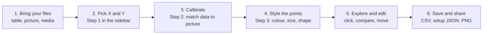
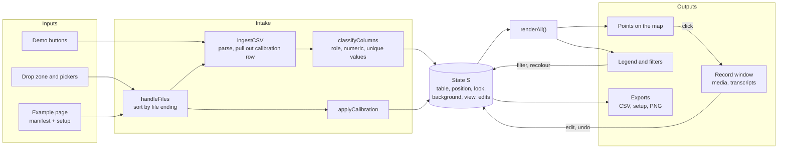

# "maplew" (a.k.a. plew-map)

Plots CSV records on a calibrated background image (a map, a figure, or a blank frame). Click a point for the full record, with audio, video, ELAN `.eaf`, and Praat TextGrid when you drop those files too.

Continuous-data sibling of [PLeW](https://github.com/len-sprague/PLeW) (also see [PLeW-NLG](https://github.com/fsame/PLeW-NLG). Column prefixes: `loc::`, `dim::`, `med::`, `desc::`.

Maplew's early versions were developed by @len-sprague (core functionality and structure) and later updated and refined by @fsame (refined plot editability, elat and textgrid functionality, and more!), both evolving in concert with research collaborator feedback. Current repo contains the most up-to-date iteration of maplew from both contributors. 

## Quick start

1. Clone and enter the repo:

```
git clone https://github.com/len-sprague/maplew.git
cd maplew
```

2. Install Hugo Extended ([releases](https://github.com/gohugoio/hugo/releases), or `brew install hugo` / `winget install Hugo.Hugo.Extended`).

3. From the project root:

```
hugo server
```

4. Open http://localhost:1313/

You can also open `plew-map.html` directly in a browser. Use **Demo: atlas map** or **Demo: TOEIC scatter** for an instant example, or drop a CSV + image (+ audio) onto the page. Example corpora (local use): http://localhost:1313/examples/

Day-to-day use: `README-plew-map.md`. Where the corpora come from: `DATA-SOURCES.md`.

## How it works

You give Maplew a table and, if you have one, a picture. It places one point per row on the picture, lets you style and explore the points, and saves the result. Everything runs in your browser; no file is uploaded.



Sidebar sections appear as each step becomes possible: a table unlocks Step 1, a background unlocks Step 2, and a valid calibration unlocks everything else.

The step-by-step version of this picture, with a table of which file does what and what each save button keeps, is on the **How it works** page: open [`how-it-works.html`](how-it-works.html) in a browser, or go to `/how-it-works/` on the site.

### For maintainers

`plew-map.html` is one file with one state object (`S`) and one redraw function (`renderAll()`). Almost every control writes to `S` and then redraws.



The How it works page has a clickable version of this map, a table of which action triggers which handler, and notes on the parts that are easy to miss. Measured slow spots, reproducible bugs and streamlining ideas are in [`REVIEW-FINDINGS.md`](REVIEW-FINDINGS.md).

## Which document do I need?

| I want to… | Read |
|------------|------|
| Understand what the tool does with my files | [`how-it-works.html`](how-it-works.html) (site: `/how-it-works/`) |
| Look up a specific control or option | [`README-plew-map.md`](README-plew-map.md) (site: `/user-guide/`) |
| Practise on ready-made files with known calibration values | [`TESTDATA-README.md`](TESTDATA-README.md) |
| Publish my own dataset as an example page | [Sharing your own example dataset](#sharing-your-own-example-dataset) below |
| Cite or re-download the example corpora | [`DATA-SOURCES.md`](DATA-SOURCES.md) |
| See what changed between versions | [`CHANGELOG.md`](CHANGELOG.md) |
| Find known slow spots and bugs before changing the code | [`REVIEW-FINDINGS.md`](REVIEW-FINDINGS.md) |
| Add plew-map to the PLeW site (one-time, historical) | [`plew-map-integration-guide.md`](plew-map-integration-guide.md) |

## Example data

Audio bundles are not in git. Download a drop-in zip from [Releases](https://github.com/fsame/plew-map/releases/tag/datasets-1.0), unzip, and drop the folder onto plew-map.

| Bundle | Contents |
|--------|----------|
| `alpilink-I01-bundle.zip` | Alpine varieties, tasks I01+I02 |
| `doreco-africa-mini.zip` | Nine DoReCo Africa languages, one text each |

ALLSSTAR (world Englishes) wavs stay on [SpeechBox](https://speechbox.linguistics.northwestern.edu/ALLSSTARcentral/#!/recordings).

## Sharing your own example dataset

If you have your own data and want collaborators to explore it in plew-map — without them needing to install anything — you can host your own copy of this site and add your dataset as a new example page. Once it's live, you just send collaborators a link.

### Step 1: Get your own copy of plew-map online

1. On GitHub, fork this repository into your own GitHub account (button in the top-right of the repo page).
2. In your fork, go to Settings → Pages, and under "Build and deployment", set Source to GitHub Actions. (This repo already includes the workflow file that builds the site with Hugo — you don't need to write one yourself.)
3. Push any commit to your fork's `main` branch (even a small one, like editing this README) to trigger the first build. You can watch its progress under the Actions tab.
4. After the build finishes (usually 1–2 minutes), your own example gallery will be live at:

```
https://<your-github-username>.github.io/<your-repo-name>/examples/
```

Bookmark this — it's your permanent home for examples going forward.

### Step 2: Add a new example dataset

Each example page is a small folder of files (your CSV, a background image, and any media) plus a short manifest and a content page that tells plew-map about it — no coding required.

1. **Prepare your CSV.** plew-map extends PLeW's column-prefix convention with one more, for coordinates:
   * `loc::` — a position coordinate, e.g. `loc::lon`, `loc::lat`, or any numeric axis like `loc::x_speech_rate`
   * `dim::` — a variable to encode with color/size/shape (e.g. `dim::language`)
   * `med::` — media: audio, image, video, or a YouTube link (e.g. `med::recording`)
   * `desc::` — descriptive text, shown only in the detail popup (e.g. `desc::transcript`)

   Prefixes are optional — plew-map falls back to name heuristics (`lat`/`lon`/`x`/`y`, `audio_url`, `transcript`, and similar) — but prefixed columns always win and are the most reliable way to get the right treatment.

2. **Add a background image and media, if you have one.** Not every dataset needs a map or figure behind it — plain scatter data is fine with no image at all. If you do have a background (a map, a scanned figure, etc.), put it, your CSV, and any audio/video/ELAN/TextGrid files together in a new folder under `static/examples/`, e.g. `static/examples/<your-dataset-name>/`. Reference media in the CSV by filename (matched by basename) or with a full `https://` link.

   Whichever you choose, make sure it actually resolves for your visitors: a bare filename only works if that file is sitting in the same folder *and* listed in the manifest (next step); a full URL needs to be a permanent address you control (your own site — e.g. `lensprague.com` — or a real hosting service), not a leftover link into a colleague's copy of the site or a personal machine, which will break for everyone but you.

3. **Calibrate (only if you have a background image).** Run `hugo server` (or open `plew-map.html` directly) and drop your CSV and image onto the page. Use Step 2 (Calibration) to tell plew-map how your coordinates map onto the image — Image edges is simplest for most maps. Once it looks right, click **💾 Save to CSV**: the download has the calibration embedded in a reserved row, so anyone who loads that file gets the correct positions automatically, with no extra sidecar file needed. Replace your draft CSV in `static/examples/<your-dataset-name>/` with this saved version.

   (If you want to offer several switchable basemaps for the same data, as the AlpiLinK example does, write a `<your-image>.png.calib.txt` sidecar per image instead — see the existing examples under `static/examples/` for the format.)

   **No background image?** Click **No background** instead of dropping an image — plew-map generates a blank frame and auto-fits the axes to your data's own coordinate range, so there's nothing to align and this calibration step can be skipped. A manifest-driven example page does the same thing automatically: if its manifest doesn't list a basemap image, plew-map creates the blank frame itself as soon as the data loads, so the plot appears right away with no extra click needed from visitors.

   You can still fine-tune the display — colors, point size/spacing, shapes, filters — under Step 3 (Encodings) and Display options, then click **📤 Export setup** to save those choices as a JSON file. Keep that file in your dataset folder alongside the CSV. On its own it's just a reference anyone can manually load via **📥 Import setup** — see the `setup` field in Step 5 below to have it applied automatically for every visitor instead.

4. **List your files in a manifest.** Create `static/examples/<your-dataset-name>/manifest.json` naming every file the example needs to load:

```json
{
  "files": [
    "your-dataset.csv",
    "your-map.png"
  ]
}
```

   List the CSV and any local media it references by filename (matched by basename) — audio, images, video, ELAN/TextGrid files, and `.calib.txt` sidecars all belong here. Media the CSV references by full `https://` URL (including YouTube links) doesn't need to be listed — a visitor's browser fetches those directly when they open a record, not through the manifest. If you have no background image, just list the CSV plus whatever local media files you have.

   Two mistakes here fail silently (the page just shows "Could not load the example dataset" with no other clue), so double-check both:
   * **The path in `manifest`** (set in Step 5 below) **must match the folder you actually created.** A typo, or renaming the folder later without updating the front matter, means every file fetch 404s.
   * **`manifest.json` must be the `{"files": [...]}` list shown above — not the JSON from Export setup.** They're two different files with two different jobs (see the `setup` field in Step 5): pointing `manifest` at a setup export instead of a real manifest fails the same way, since there's no `files` array in it to read.

5. **Create the content page.** From a terminal in the project folder, run:

```
hugo new content/examples/<your-dataset-name>.md
```

Open the new file, remove the `draft = true` line so it will actually publish, and fill in the rest:

```
+++
title = "My Dataset"
description = "A short description shown on the example gallery card."
layout = "example-map"
manifest = "examples/<your-dataset-name>/manifest.json"
setup = "examples/<your-dataset-name>/your-setup-file.json"
weight = 10
+++
```

`weight` controls where the page appears in the example gallery (lower numbers first). `setup` is optional: point it at a JSON file you saved earlier with **📤 Export setup**, and plew-map applies those encodings, filters, calibration, and column roles automatically as soon as the dataset loads — visitors see your exact curated view with nothing to import themselves. Leave it out and visitors see the raw data with default styling instead.

6. **Test locally.** With `hugo server` running, open `http://localhost:1313/examples/<your-dataset-name>/` and confirm your data loads, positions look right (calibration, or the auto-fit blank frame), and any media plays correctly. Adjust column prefixes or calibration as needed.

### Step 3: Publish and share

1. Commit your changes and push them to your fork (directly to `main`, or via a pull request into your own `main` if you prefer to review first).
2. Once the changes are on `main`, GitHub Actions automatically rebuilds and redeploys your site — no extra steps needed.
3. Your new dataset will be live at:

```
https://<your-github-username>.github.io/<your-repo-name>/examples/<your-dataset-name>/
```

4. Share that link directly with collaborators — it opens straight into plew-map with your dataset already loaded and positioned (calibrated against your background image, or auto-fit into a blank frame if you have none), no upload required. If you set a `setup` file, your saved colors, filters, and encodings apply automatically too.

## Troubleshooting

| Problem | Fix |
|---------|-----|
| `hugo` is not recognized | Install Hugo Extended and open a new terminal |
| Page will not load | Check that `hugo server` is still running |
| Port 1313 in use | `hugo server --port 1314` |
